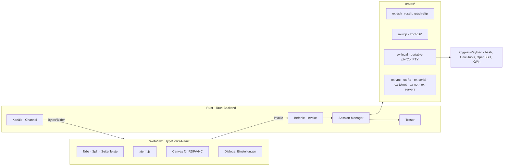

# Architektur

OpenXterm ist eine **Tauri-2-App**: Die Oberfläche ist eine Webseite (TypeScript + React) in einem WebView-Fenster, die Logik läuft in **Rust**. Protokolle kommen aus Rust-Bibliotheken (russh, IronRDP …), Unix-Werkzeuge und X-Server wie beim Vorbild aus **Cygwin**.

> 💡 **Warum diese Aufteilung?** Die Oberfläche als Webseite lässt sich überall anzeigen und testen – auch in der Linux-Cloud, wo Claude sie per Screenshot prüft. Rust ist schnell, sicher im Umgang mit Speicher und erzeugt eine kleine EXE. Und für fast jedes Protokoll gibt es eine gepflegte Rust-Bibliothek.

## 1. Überblick



## 2. Wie Oberfläche und Rust miteinander reden

Tauri bietet drei Wege. Wir nutzen jeden für seinen Zweck:

| Weg | Richtung | Wofür in OpenXterm | Beispiel |
|---|---|---|---|
| **Befehl** (`invoke`) | WebView → Rust, mit Antwort | Aktionen, Anfragen | `ssh_connect`, `term_write`, `sessions_list` |
| **Kanal** (`tauri::ipc::Channel`) | Rust → WebView, Datenstrom | Terminal-Ausgabe, RDP-Bildausschnitte, Transfer-Fortschritt | Bytes vom Server an xterm.js |
| **Ereignis** (`emit`/`listen`) | Rust → WebView, global | seltene Meldungen | „Host-Key unbekannt“, „Tunnel getrennt“ |

Große Datenmengen (Terminal-Ausgabe, Bilddaten) gehen als **Rohbytes** über Kanäle, nicht als JSON – das ist der Schlüssel zu guter Geschwindigkeit. Der vollständige Vertrag (Namen, Parameter, Formate) steht im Skill `tauri-schnittstelle` und wird mit jedem Feature gepflegt.

## 3. Datenfluss je Session-Typ

**SSH-Terminal**
```
xterm.js onData ──invoke term_write──► ox-ssh: channel.data()
russh Channel ──► Lesetask ──Channel<Bytes>──► xterm.js write()
xterm.js onResize ──invoke term_resize──► channel.window_change()
```

**RDP**
```
ironrdp-client ──Ausgabe-Ereignisse──► ox-rdp: geänderte Rechtecke als RGBA
  ──Channel<Bytes: x,y,w,h,Pixel>──► Canvas putImageData()
Canvas Maus/Tastatur ──invoke rdp_input──► ironrdp-client Eingabe
Tab-Größe ändert sich ──invoke rdp_resize──► Display Control (dynamische Auflösung)
```

Weil RDP in ein **Canvas** gezeichnet wird, ist es ein normaler Teil der Webseite: Menüs und Dialoge liegen problemlos darüber, Split-Ansichten funktionieren. (Mit einem eingebetteten Windows-Steuerelement wäre das nicht so.)

**Lokale Shell**
```
portable-pty (ConPTY) ◄──► powershell.exe | cmd.exe | wsl.exe -d <Distro> | Cygwin bash
```

## 4. Projektstruktur

```
OpenXterm/
  Cargo.toml              Cargo-Workspace (alle Rust-Teile)
  app/                    die Tauri-App
    package.json          Frontend: Vite + React + TypeScript
    src/                  Oberfläche (Komponenten, Stores, xterm.js, Canvas)
    src-tauri/            Rust-Teil der App: Befehle, Kanäle, App-Zustand
  crates/
    ox-core/              Modelle, Konfiguration, Tresor, Host-Keys – ohne Tauri, voll testbar
    ox-ssh/               Terminal, SFTP, Tunnel, Agent (russh)
    ox-rdp/               RDP-Sitzung (IronRDP)
    ox-local/             lokale Shells (portable-pty)
    …                     weitere Protokolle je Phase
  spikes/                 Wegwerf-Prototypen mit ERGEBNIS.md (werden nicht weiterentwickelt)
  testing/                Testserver (SSH, xrdp), Screenshot-Skript
  tools/oxdev-mcp/        eigener MCP-Server für die Entwicklung (Phase 7)
  docs/                   diese Dokumentation, Specs
  cloud/setup.sh          Einrichtung der Cloud-Umgebung
  .claude/                Skills, Subagenten, Hooks, Berechtigungen
```

**Grundsatz:** Logik gehört in `crates/` und ist dort ohne Oberfläche testbar (`cargo test`). `app/src-tauri` ist eine dünne Schicht, die Befehle entgegennimmt und an die Crates weiterreicht.

## 5. Datenablage

| Datei | Inhalt |
|---|---|
| `OpenXterm.toml` | Einstellungen, Sessions (Ordnerbaum), Makros, Tunnel |
| `vault.bin` | Tresor: Passwörter/Passphrasen, verschlüsselt |
| `known_hosts` | bekannte SSH-Host-Keys (OpenSSH-Format) |
| `rdp_certs.toml` | bestätigte RDP-Zertifikate (Fingerprints) |
| `logs/` | Debug-Log (ohne Geheimnisse), Terminal-Logs |

Ort wie beim Vorbild: neben der EXE, wenn dort eine Datei `portable` liegt (USB-Stick), sonst `%APPDATA%\OpenXterm`. Import aus einer MobaXterm-INI ist eine eigene Funktion (SES-13).

## 6. Komponenten und Bibliotheken

| Bereich | Lösung | Lizenz |
|---|---|---|
| App-Gerüst | Tauri 2 | MIT / Apache-2.0 |
| Oberfläche | React, TypeScript, Vite | MIT |
| Terminal | xterm.js + Addons (fit, search, web-links, webgl) | MIT |
| SSH, SFTP, Tunnel, SSH-Server | russh, russh-sftp | Apache-2.0 |
| RDP | IronRDP (`ironrdp-client` u. a.); bei Bedarf Fork `deadsway/IronRDP` | MIT / Apache-2.0 |
| Lokale Shells | portable-pty (ConPTY unter Windows) | MIT |
| Serielle Schnittstelle | serialport | MPL-2.0 |
| FTP/FTPS | suppaftp | MIT / Apache-2.0 |
| Editor im Programm | CodeMirror 6 | MIT |
| Diff | similar | Apache-2.0 |
| Tresor | argon2, aes-gcm (RustCrypto); DPAPI über `windows`-Crate | MIT / Apache-2.0 |
| Unix-Werkzeuge, X-Server, Mosh | Cygwin (+ XWin) | DLL LGPLv3, Programme diverse |
| Installer | Tauri-Bundler (NSIS/MSI) | – |

Vor jeder neuen Abhängigkeit Lizenz prüfen und in `THIRD-PARTY-NOTICES.md` eintragen (Subagent `code-reviewer` achtet darauf).

## 7. Tests

| Ebene | Werkzeug | Wo |
|---|---|---|
| Rust-Einheitentests | `cargo test` | überall |
| Frontend-Einheitentests | Vitest | überall |
| Integration SSH/SFTP/Tunnel | `cargo test -- --ignored` gegen Testserver | Cloud (`testing/testenv.sh`), Windows (Docker) |
| Integration RDP | gegen xrdp (TLS) und IronRDP-Beispielserver (NLA) | Cloud, Windows |
| Oberfläche | App unter Xvfb starten, Screenshot (`testing/shot.sh`), Claude sieht ihn an | Cloud |
| Windows-Spezifisches | manuell nach Checkliste in der Spec; GitHub Actions baut auf `windows-latest` | Windows |

## 8. Entscheidungen (ADRs)

**ADR-1 · Tauri 2 mit Rust und TypeScript.** Statt Pascal/Delphi wie das Vorbild. Gründe: Oberfläche und fast alle Logik sind in der Linux-Cloud bau- und testbar; Claude beherrscht beide Sprachen sehr gut; kleine EXE; gepflegte Bibliotheken für SSH, RDP, Terminal. Preis: WebView2 muss vorhanden sein (unter Windows 10/11 vorinstalliert).

**ADR-2 · xterm.js als Terminal.** Ausgereift, schnell (WebGL), sehr verbreitet (VS Code). Ersetzt den PuTTY-Terminal des Vorbilds.

**ADR-3 · russh für SSH.** Reines Rust, asynchron (tokio), kann Client und Server, SFTP über russh-sftp. Ersetzt PuTTY. Grenzen (z. B. X11-Forwarding, FIDO) werden je Feature geprüft; Ausweg ist das in Windows enthaltene `ssh.exe` in einem lokalen Terminal.

**ADR-4 · IronRDP für RDP, gezeichnet in ein Canvas.** Kein „Airspace“-Problem, in der Cloud gegen xrdp testbar. Grenzen: kein volles Funktionsset des Microsoft-Clients (z. B. Mehrfachmonitor). Ausweg für Sonderfälle: Knopf „in Remotedesktopverbindung öffnen“ (`mstsc.exe` mit erzeugter `.rdp`-Datei). Eigene Änderungen an IronRDP im Fork `deadsway/IronRDP`, eingebunden per `[patch.crates-io]`.

**ADR-5 · Cygwin für Unix-Werkzeuge und X-Server.** Wie das Vorbild. Ausgeliefert als ZIP neben der EXE oder beim ersten Start entpackt – Entscheidung in Phase 2 per Spike.

**ADR-6 · TOML statt INI.** Strukturierte Sessions mit serde, menschenlesbar. MobaXterm-INI wird importiert, nicht als eigenes Format genutzt.

**ADR-7 · Ein Prozess, viele Tokio-Tasks.** Jede Session ist ein Task im selben Prozess. Abstürze werden durch Rust-Fehlerbehandlung statt Prozessgrenzen eingedämmt (`Result` statt `unwrap`, Panics pro Task abfangen).
